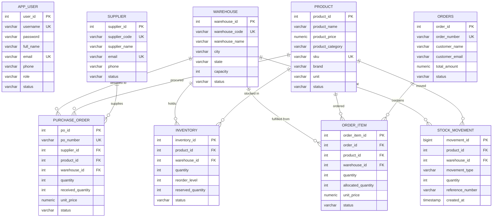

# RIMS Relational Database Design & Data Dictionary
**System:** Retail Inventory Management System (RIMS)  
**Project Code:** `PRG_RIMS_001`  
**Database Engine:** PostgreSQL 16 Alpine  
**Database Name:** `hcl`  
**Connection URL:** `jdbc:postgresql://localhost:5432/hcl` (Local) / `jdbc:postgresql://db:5432/hcl` (Docker)  
**Last Updated:** October 28, 2026  

---

## 1. Schema Architecture & Entity Relationship Overview

The RIMS database is normalized to 3rd Normal Form (3NF) to guarantee transactional consistency, eliminate data redundancy, and ensure high-throughput OLTP operations across 500+ store locations.

### Key Design Highlights:
1. **Multi-Location Topology:** The `warehouse` table acts as the unified physical site registry for both central regional distribution centers and individual retail stores.
2. **Composite Uniqueness on Inventory:** The `uq_product_warehouse` unique constraint guarantees that a given product SKU exists exactly once per warehouse record in the `inventory` table.
3. **Double-Entry Stock Audit Trail:** The `stock_movement` table functions as an immutable ledger tracking all inbound supplier receipts (`INBOUND_PO`), outbound customer sales (`OUTBOUND_SALE`), warehouse transfers (`TRANSFER_OUT`, `TRANSFER_IN`), and manual count adjustments (`ADJUSTMENT`).
4. **Reservation Integrity:** A CHECK constraint (`chk_reserved_lte_qty`) enforces that `reserved_quantity <= quantity`, preventing overselling and phantom inventory reservations.

---

## 2. Relational Data Dictionary

### 2.1 Table: `app_user`
Stores user credentials, granular role classifications, and account lock security states.

| Column | Data Type | Nullable | Constraints / Default | Description |
|:---|:---|:---|:---|:---|
| `user_id` | SERIAL | NO | PRIMARY KEY | Unique surrogate identifier |
| `username` | VARCHAR(50) | NO | UNIQUE | Case-insensitive login username |
| `password` | VARCHAR(100) | NO | — | BCrypt-hashed password string (strength 10) |
| `full_name` | VARCHAR(150) | NO | — | User's legal full name |
| `email` | VARCHAR(150) | NO | UNIQUE | Corporate email address |
| `phone` | VARCHAR(15) | NO | — | Contact telephone number |
| `role` | VARCHAR(30) | NO | DEFAULT 'STORE_STAFF' | Role: ADMIN, STORE_MANAGER, WAREHOUSE_STAFF, AUDITOR |
| `status` | VARCHAR(20) | NO | DEFAULT 'ACTIVE' | Status: ACTIVE, INACTIVE, LOCKED, SUSPENDED |
| `failed_login_attempts` | INT | NO | DEFAULT 0 | Counter for failed logins (lockout threshold = 5) |
| `locked_until` | TIMESTAMP | YES | NULL | Expiration timestamp for automatic lock release |
| `last_login_at` | TIMESTAMP | YES | NULL | Last successful authentication timestamp |
| `created_at` | TIMESTAMP | NO | DEFAULT CURRENT_TIMESTAMP | Audit creation timestamp |
| `updated_at` | TIMESTAMP | NO | DEFAULT CURRENT_TIMESTAMP | Audit modification timestamp |

*Indexes:*
- `idx_user_username` on `LOWER(username)`
- `idx_user_email` on `LOWER(email)`

---

### 2.2 Table: `product`
Master catalog containing apparel, electronics, and home goods metadata.

| Column | Data Type | Nullable | Constraints / Default | Description |
|:---|:---|:---|:---|:---|
| `product_id` | SERIAL | NO | PRIMARY KEY | Unique surrogate identifier |
| `product_name` | VARCHAR(100) | NO | — | Official commercial product name |
| `product_price` | NUMERIC(12,2) | NO | CHECK (product_price > 0) | Retail sales price per unit in INR (₹) |
| `product_category` | VARCHAR(50) | NO | — | Category: Apparel, Electronics, Home Goods |
| `sku` | VARCHAR(50) | NO | UNIQUE | Stock Keeping Unit code |
| `brand` | VARCHAR(100) | YES | NULL | Brand / manufacturer name |
| `description` | VARCHAR(500) | YES | NULL | Detailed specifications / merchandising copy |
| `image_url` | VARCHAR(255) | YES | NULL | Relative or absolute URL to product imagery |
| `unit` | VARCHAR(20) | NO | — | Unit of Measure: PIECE, BOX, KG, METER, PAIR |
| `status` | VARCHAR(20) | NO | DEFAULT 'ACTIVE' | Status: ACTIVE, INACTIVE, DISCONTINUED |
| `created_at` | TIMESTAMP | NO | DEFAULT CURRENT_TIMESTAMP | Record creation timestamp |
| `updated_at` | TIMESTAMP | NO | DEFAULT CURRENT_TIMESTAMP | Record modification timestamp |

*Indexes:*
- `idx_product_sku` on `LOWER(sku)`
- `idx_product_category` on `LOWER(product_category)`

---

### 2.3 Table: `warehouse`
Registry of physical warehouses, distribution hubs, and retail stores across the network.

| Column | Data Type | Nullable | Constraints / Default | Description |
|:---|:---|:---|:---|:---|
| `warehouse_id` | SERIAL | NO | PRIMARY KEY | Unique surrogate identifier |
| `warehouse_code` | VARCHAR(50) | NO | UNIQUE | Unique warehouse identifier (e.g., WH-DEL-01, STR-MUM-12) |
| `warehouse_name` | VARCHAR(100) | NO | — | Descriptive location name |
| `warehouse_location` | VARCHAR(100) | NO | — | Geographic zone / facility hub designation |
| `address` | VARCHAR(200) | NO | — | Physical street address |
| `city` | VARCHAR(50) | NO | — | City name |
| `state` | VARCHAR(50) | NO | — | State / Province |
| `pincode` | VARCHAR(20) | NO | — | Postal / ZIP code |
| `manager_name` | VARCHAR(100) | YES | NULL | Responsible site manager |
| `contact_number` | VARCHAR(20) | YES | NULL | Facility contact phone |
| `email` | VARCHAR(100) | YES | NULL | Facility dispatch email |
| `capacity` | INT | YES | CHECK (capacity >= 0) | Maximum storage capacity in unit volume |
| `status` | VARCHAR(20) | NO | DEFAULT 'ACTIVE' | Status: ACTIVE, INACTIVE, MAINTENANCE |
| `created_at` | TIMESTAMP | NO | DEFAULT CURRENT_TIMESTAMP | Creation timestamp |
| `updated_at` | TIMESTAMP | NO | DEFAULT CURRENT_TIMESTAMP | Update timestamp |

*Indexes:*
- `idx_warehouse_code` on `LOWER(warehouse_code)`

---

### 2.4 Table: `inventory`
Tracks on-hand physical stock, safety stock reorder levels, and reserved allocations per location.

| Column | Data Type | Nullable | Constraints / Default | Description |
|:---|:---|:---|:---|:---|
| `inventory_id` | SERIAL | NO | PRIMARY KEY | Unique surrogate identifier |
| `product_id` | INT | NO | REFERENCES product(product_id) | Foreign key to product master |
| `warehouse_id` | INT | NO | REFERENCES warehouse(warehouse_id) | Foreign key to warehouse location |
| `quantity` | INT | NO | DEFAULT 0, CHECK (quantity >= 0) | Physical stock count on hand |
| `reorder_level` | INT | NO | DEFAULT 10, CHECK (reorder_level >= 0) | Minimum stock threshold triggering low-stock alerts |
| `reserved_quantity` | INT | NO | DEFAULT 0, CHECK (reserved_quantity >= 0) | Stock reserved for confirmed customer orders |
| `status` | VARCHAR(20) | NO | DEFAULT 'ACTIVE' | Status: ACTIVE, DISCONTINUED, AUDIT_LOCK |
| `created_at` | TIMESTAMP | NO | DEFAULT CURRENT_TIMESTAMP | Record creation timestamp |
| `updated_at` | TIMESTAMP | NO | DEFAULT CURRENT_TIMESTAMP | Record modification timestamp |

*Table Constraints:*
- `uq_product_warehouse`: `UNIQUE (product_id, warehouse_id)`
- `chk_reserved_lte_qty`: `CHECK (reserved_quantity <= quantity)`

*Indexes:*
- `idx_inv_product` on `product_id`
- `idx_inv_warehouse` on `warehouse_id`

---

### 2.5 Table: `supplier`
Master profiles for commercial vendors, suppliers, and distributors.

| Column | Data Type | Nullable | Constraints / Default | Description |
|:---|:---|:---|:---|:---|
| `supplier_id` | SERIAL | NO | PRIMARY KEY | Unique surrogate identifier |
| `supplier_code` | VARCHAR(50) | NO | UNIQUE | Vendor account code |
| `supplier_name` | VARCHAR(100) | NO | — | Company legal entity name |
| `contact_person` | VARCHAR(100) | YES | NULL | Primary account representative |
| `email` | VARCHAR(100) | NO | UNIQUE | Procurement contact email |
| `phone` | VARCHAR(20) | NO | — | Commercial phone number |
| `address` | VARCHAR(200) | NO | — | Vendor billing address |
| `city` | VARCHAR(50) | NO | — | City |
| `state` | VARCHAR(50) | NO | — | State / Province |
| `pincode` | VARCHAR(20) | NO | — | Postal code |
| `tax_id` | VARCHAR(50) | YES | NULL | Tax registration / GSTIN number |
| `payment_terms` | VARCHAR(50) | YES | NULL | Credit terms: NET30, NET60, COD, PREPAID |
| `status` | VARCHAR(20) | NO | DEFAULT 'ACTIVE' | Status: ACTIVE, INACTIVE, BLACKLISTED |
| `created_at` | TIMESTAMP | NO | DEFAULT CURRENT_TIMESTAMP | Creation timestamp |
| `updated_at` | TIMESTAMP | NO | DEFAULT CURRENT_TIMESTAMP | Modification timestamp |

*Indexes:*
- `idx_supplier_code` on `LOWER(supplier_code)`

---

### 2.6 Table: `purchase_order`
Procurement orders submitted to external suppliers for inventory replenishment.

| Column | Data Type | Nullable | Constraints / Default | Description |
|:---|:---|:---|:---|:---|
| `po_id` | SERIAL | NO | PRIMARY KEY | Unique surrogate identifier |
| `po_number` | VARCHAR(50) | NO | UNIQUE | Business reference number (e.g., PO-2026-001) |
| `supplier_id` | INT | NO | REFERENCES supplier(supplier_id) | Target supplier |
| `product_id` | INT | NO | REFERENCES product(product_id) | Ordered SKU |
| `warehouse_id` | INT | NO | REFERENCES warehouse(warehouse_id) | Destination warehouse facility |
| `quantity` | INT | NO | CHECK (quantity > 0) | Quantity ordered |
| `received_quantity` | INT | NO | DEFAULT 0, CHECK (received_quantity >= 0) | Cumulative quantity received and inspected |
| `unit_price` | NUMERIC(12,2) | NO | CHECK (unit_price > 0) | Agreed unit cost price |
| `total_amount` | NUMERIC(12,2) | NO | — | Total purchase order cost (`quantity * unit_price`) |
| `expected_delivery_date` | DATE | YES | NULL | Expected delivery date |
| `status` | VARCHAR(30) | NO | DEFAULT 'DRAFT' | Status: DRAFT, ORDERED, PARTIALLY_RECEIVED, RECEIVED, CANCELLED |
| `notes` | VARCHAR(500) | YES | NULL | Procurement instructions |
| `created_at` | TIMESTAMP | NO | DEFAULT CURRENT_TIMESTAMP | PO issue timestamp |
| `updated_at` | TIMESTAMP | NO | DEFAULT CURRENT_TIMESTAMP | Status change timestamp |

*Indexes:*
- `idx_po_number` on `LOWER(po_number)`

---

### 2.7 Table: `orders`
Outbound sales orders placed by customers across retail channels.

| Column | Data Type | Nullable | Constraints / Default | Description |
|:---|:---|:---|:---|:---|
| `order_id` | SERIAL | NO | PRIMARY KEY | Unique surrogate identifier |
| `order_number` | VARCHAR(50) | NO | UNIQUE | Business reference number (e.g., ORD-2026-0001) |
| `customer_name` | VARCHAR(100) | NO | — | Customer full name |
| `customer_email` | VARCHAR(100) | NO | — | Customer email address |
| `customer_phone` | VARCHAR(20) | YES | NULL | Customer phone |
| `shipping_address` | VARCHAR(255) | NO | — | Physical shipping delivery address |
| `city` | VARCHAR(50) | NO | — | Destination city |
| `state` | VARCHAR(50) | NO | — | Destination state |
| `pincode` | VARCHAR(20) | NO | — | Destination postal code |
| `total_amount` | NUMERIC(12,2) | NO | DEFAULT 0.00 | Sum of line item subtotals |
| `status` | VARCHAR(30) | NO | DEFAULT 'DRAFT' | Status: DRAFT, CONFIRMED, PICKED, PACKED, SHIPPED, DELIVERED, CANCELLED |
| `notes` | VARCHAR(500) | YES | NULL | Special handling / delivery instructions |
| `created_at` | TIMESTAMP | NO | DEFAULT CURRENT_TIMESTAMP | Order creation timestamp |
| `updated_at` | TIMESTAMP | NO | DEFAULT CURRENT_TIMESTAMP | Status update timestamp |

*Indexes:*
- `idx_order_number` on `LOWER(order_number)`

---

### 2.8 Table: `order_item`
Detailed line items representing individual product quantities within a sales order.

| Column | Data Type | Nullable | Constraints / Default | Description |
|:---|:---|:---|:---|:---|
| `order_item_id` | SERIAL | NO | PRIMARY KEY | Unique surrogate identifier |
| `order_id` | INT | NO | REFERENCES orders(order_id) ON DELETE CASCADE | Parent order reference |
| `product_id` | INT | NO | REFERENCES product(product_id) | Master product reference |
| `warehouse_id` | INT | NO | REFERENCES warehouse(warehouse_id) | Fulfillment warehouse location |
| `quantity` | INT | NO | CHECK (quantity > 0) | Quantity ordered |
| `unit_price` | NUMERIC(12,2) | NO | CHECK (unit_price > 0) | Sale price at time of order intake |
| `allocated_quantity` | INT | NO | DEFAULT 0, CHECK (allocated_quantity >= 0) | Quantity physically reserved from warehouse inventory |
| `subtotal` | NUMERIC(12,2) | NO | — | Line item total (`quantity * unit_price`) |
| `status` | VARCHAR(30) | NO | DEFAULT 'PENDING' | Status: PENDING, ALLOCATED, PICKED, PACKED, SHIPPED, CANCELLED |
| `created_at` | TIMESTAMP | NO | DEFAULT CURRENT_TIMESTAMP | Item creation timestamp |
| `updated_at` | TIMESTAMP | NO | DEFAULT CURRENT_TIMESTAMP | Item modification timestamp |

*Indexes:*
- `idx_order_item_order` on `order_id`

---

### 2.9 Table: `stock_movement`
Immutable, append-only double-entry ledger recording all physical stock changes.

| Column | Data Type | Nullable | Constraints / Default | Description |
|:---|:---|:---|:---|:---|
| `movement_id` | BIGSERIAL | NO | PRIMARY KEY | Unique surrogate ledger sequence |
| `product_id` | INT | NO | REFERENCES product(product_id) | Target product |
| `warehouse_id` | INT | NO | REFERENCES warehouse(warehouse_id) | Affected facility |
| `movement_type` | VARCHAR(30) | NO | — | INBOUND_PO, OUTBOUND_SALE, TRANSFER_OUT, TRANSFER_IN, RETURN_RESTOCK, ADJUSTMENT |
| `quantity` | INT | NO | — | Quantity moved (signed integer or magnitude) |
| `reference_number` | VARCHAR(100) | YES | NULL | Originating document ID (e.g., PO #, Order #, Transfer #) |
| `reason` | VARCHAR(255) | YES | NULL | Business reason or destination warehouse note |
| `performed_by` | VARCHAR(100) | YES | NULL | Username of operating staff member |
| `created_at` | TIMESTAMP | NO | DEFAULT CURRENT_TIMESTAMP | Immutable event timestamp |

*Indexes:*
- `idx_movement_product` on `product_id`
- `idx_movement_warehouse` on `warehouse_id`
- `idx_movement_created` on `created_at DESC`
