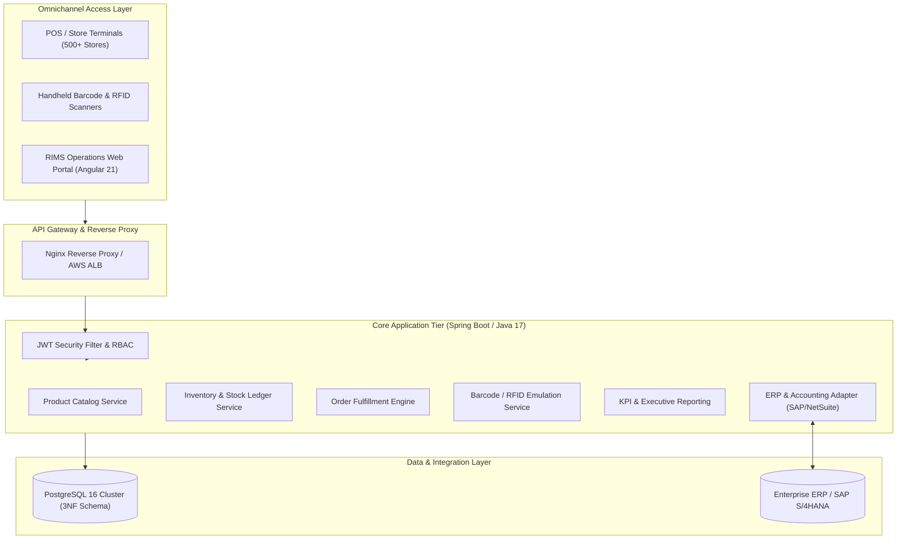

# Retail Inventory Management System (RIMS)
**Project Code:** `PRG_RIMS_001`  
**Client:** XYZ Retail Corporation  
**Classification:** Enterprise Multi-Location Supply Chain Solution  
**Target Topology:** National Retail Network (500+ Stores, Regional Warehouses, Central DCs)  

---

## 1. Executive Summary & Project Vision

**XYZ Retail Corporation** operates a nationwide retail enterprise encompassing 500+ brick-and-mortar storefronts, multiple regional distribution centers (DCs), and high-volume e-commerce channels across three core product categories: **Apparel**, **Home Goods**, and **Electronics**.

The **Retail Inventory Management System (RIMS)** is a unified, real-time, cloud-native inventory tracking, replenishment, and order fulfillment platform designed to eliminate stockouts, prevent overstock accumulation, and ensure end-to-end supply chain visibility.



---

## 2. SMART Objectives & Milestone Mapping

| SMART Objective | Baseline Target | System Enforcement Mechanism |
|---|---|---|
| **Inventory Accuracy** | **≥ 98% accuracy** across all warehouses and stores within 6 months | Real-time dual-entry stock ledger (`stock_movement`), RFID scanning verification, reserved allocation locks |
| **Stockout Reduction** | **Reduce stockouts by 25%** in Year 1 | Configurable per-store reorder thresholds (`reorder_level`), automated low-stock query alerts |
| **Overstock Reduction** | **Reduce overstock by 20%** in Year 1 | Store-level turnover analytics, demand-driven purchase orders, inter-store transfers |
| **Order Fulfillment Rate** | **≥ 95% on-time fulfillment** in Year 1 | Real-time stock allocation before order confirmation, warehouse proximity routing |
| **System Reliability** | **99.9% uptime** SLA | Dockerized container architecture, stateless JWT auth, multi-AZ RDS deployment via Terraform |

---

## 3. Architecture & Technical Stack

### Front-End Tier (`angular-auth/`)
- **Framework:** Angular 21 (Standalone Components, Signals API, OnPush change detection)
- **Styling:** Custom Enterprise CSS (Responsive design, DM Sans & Fraunces typography, CSS Variables)
- **State & Form Management:** Angular Reactive Forms, Angular Signals (`signal()`, `computed()`), RxJS
- **Security:** Functional `authInterceptor` (automatic Bearer injection), `authGuard`, `guestGuard`
- **Testing:** Vitest & JSDOM test runner

### Back-End Tier (`auth-backend/`)
- **Runtime & Framework:** Java 17, Spring Boot 4
- **Security:** Spring Security 6 (Stateless JWT Filter Chain, BCrypt password hashing)
- **Persistence:** Spring Data JPA, Hibernate, Relational Constraints
- **API Documentation:** SpringDoc OpenAPI 2.8+ / Swagger UI (`/swagger-ui.html`)
- **Testing:** JUnit 5, Mockito, Spring Security Test

### Database Tier (`database/`)
- **Database Engine:** PostgreSQL 16+
- **Schema Design:** Fully normalized 3NF relational schema, check constraints, foreign keys with referential integrity, B-Tree indexes on SKU, codes, and audit dates
- **Init Automation:** Automated `01-schema.sql` and `02-seed.sql` mount in Docker Compose

### DevOps, Cloud & Tooling
- **Containerization:** Multi-stage `Dockerfile` (Spring Boot JAR & Angular Nginx)
- **Orchestration:** `docker-compose.yml` linking database, backend API, and frontend proxy
- **CI/CD Automation:** GitHub Actions (`.github/workflows/ci-cd.yml`) executing compilation, unit tests, and container image builds
- **Infrastructure as Code (IaC):** Terraform AWS modules (`infrastructure/`) provisioning VPC, multi-AZ RDS PostgreSQL, ECS Fargate, and ALB

---

## 4. Business Epics & Functional Scope (15 Sprints)

```
├── Epic 1: Product Catalog Management ──────── CRUD catalog, SKU uniqueness, multi-field search, pricing
├── Epic 2: Inventory Tracking & Multi-Store ─ Multi-location stock levels, reserved locks, low-stock alerts
├── Epic 3: Order Management & Fulfillment ─── Customer order lifecycle (DRAFT -> CONFIRMED -> FULFILLED)
├── Epic 4: Supplier & Purchase Orders ────── Vendor directory, purchase orders, restocking receipt flows
├── Epic 5: Barcode & RFID Integration ────── Handheld barcode scanner lookup & RFID portal batch auditing
├── Epic 6: Reporting & Analytics ────────── Executive KPIs, inventory valuation, category distribution
├── Epic 7: User Management & RBAC ────────── JWT token issuance, password policies, multi-role permissions
└── Epic 8: System Integration (ERP Mock) ─── SAP S/4HANA / NetSuite master sync & inventory export feeds
```

---

## 5. Role-Based Access Control (RBAC) Matrix

| Operation / Module | Admin | Store Manager | Warehouse Staff | Auditor | Supplier |
|---|:---:|:---:|:---:|:---:|:---:|
| **Manage Users & Permissions** | ✅ Full | ❌ None | ❌ None | ❌ None | ❌ None |
| **Product Catalog (CRUD)** | ✅ Full | 👁 View Only | 👁 View Only | 👁 View Only | 👁 View Only |
| **Stock Levels (Adjust / Transfer)** | ✅ Full | ✅ Store Only | ✅ DC Only | 👁 View Only | ❌ None |
| **Purchase Orders (Create / Place)** | ✅ Full | ✅ Request | ❌ None | 👁 View Only | 👁 Assigned Only |
| **Receive PO Inventory** | ✅ Full | ✅ Store Only | ✅ DC Only | ❌ None | ❌ None |
| **Barcode / RFID Terminal** | ✅ Full | ✅ Allowed | ✅ Allowed | ✅ Audit Mode | ❌ None |
| **Executive Analytics & Reports** | ✅ Full | ✅ Store KPIs | ❌ None | ✅ Audit Logs | ❌ None |
| **ERP Master Data Sync** | ✅ Full | ❌ None | ❌ None | 👁 Logs Only | ❌ None |

---

## 6. Seed Credentials for Local Testing

All seed accounts are pre-configured with the default password: **`Password123!`**

| Username | Full Name | Role | Access Scope |
|---|---|---|---|
| `admin` | System Administrator | `ADMIN` | Unrestricted enterprise-wide access |
| `manager.north` | Rajesh Sharma | `STORE_MANAGER` | Store #502 inventory, orders, restocking |
| `staff.mumbai` | Pooja Verma | `WAREHOUSE_STAFF` | Western Central DC inventory, receiving, scanning |
| `auditor.lead` | Sunil Narang | `AUDITOR` | Stock ledger verification, audit logs, reports |

---

## 7. Quickstart Guide

### Option A: Run Entire Stack via Docker Compose (Recommended)

Ensure [Docker](https://www.docker.com/) and [Docker Compose](https://docs.docker.com/compose/) are installed:

```bash
# 1. Clone the repository
git clone https://github.com/xyz-retail/RIMS.git
cd RIMS

# 2. Copy environment template
cp .env.example .env

# 3. Spin up Database, Backend, and Frontend containers
docker compose up --build
```

Access the applications:
- **RIMS Web Application:** `http://localhost:80`
- **Spring Boot REST API:** `http://localhost:8080`
- **Swagger / OpenAPI Documentation:** `http://localhost:8080/swagger-ui.html`
- **PostgreSQL Database:** `localhost:5432` (`hcl` / `postgres` / `1909`)

---

### Option B: Local Development Setup (Bare Metal)

#### 1. Database Setup
Start a local PostgreSQL server on port `5432`, create database `hcl`, and run the schema and seed scripts:
```bash
psql -U postgres -d hcl -f database/schema.sql
psql -U postgres -d hcl -f database/seed.sql
```

#### 2. Backend API Setup
```bash
cd auth-backend

# Verify dependencies and run tests
./mvnw clean test

# Run Spring Boot application (launches on port 8080)
./mvnw spring-boot:run
```

Navigate your browser to `http://localhost:4200` to interact with the live portal.

---

## 8. REST API Reference & Swagger Specification

When the backend is running, the interactive OpenAPI specification is available at:
👉 **`http://localhost:8080/swagger-ui.html`**

### Key REST Endpoints

| HTTP Method | Route | Description |
|---|---|---|
| `POST` | `/auth/login` | Authenticate with username & password to receive JWT |
| `GET` / `POST` | `/products` | List all products / Create new catalog item |
| `GET` / `PUT` | `/products/{id}` | Retrieve or update product by ID |
| `GET` | `/products/search/name?name={q}` | Search catalog by product name |
| `GET` / `POST` | `/inventory` | List multi-warehouse stock levels / Add inventory |
| `GET` | `/inventory/low-stock` | Retrieve SKUs falling below reorder threshold |
| `GET` / `POST` | `/stock-movements` | Query stock movement audit ledger / Record transfer |
| `GET` | `/scanner/scan?barcode={sku}` | Emulate barcode scanner for instant stock lookup |
| `POST` | `/scanner/rfid-batch` | Emulate RFID antenna batch scan for inbound/outbound |
| `GET` | `/analytics/kpis` | Executive KPI dashboard metrics and inventory valuation |
| `GET` | `/analytics/categories` | Stock valuation breakdown by product category |
| `GET` | `/integration/erp/status` | Check SAP / NetSuite integration connector health |
| `GET` | `/integration/erp/export-inventory` | Generate standardized ERP snapshot export payload |

---

## 9. Automated Testing & Quality Gates

### Backend Unit & Integration Tests (JUnit 5 + Mockito)
```bash
cd auth-backend
./mvnw test
```
Test suite includes:
- `ProductServiceTest`: Catalog CRUD, duplicate SKU rejection, category/brand search.
- `AppUserServiceTest`: Password hashing, duplicate checks, account locking, password change.
- `InventoryServiceTest`: Multi-warehouse stock tracking, low-stock threshold queries.

### Frontend Component & Service Tests (Vitest)
```bash
cd angular-auth
npm test -- --run
```

---

## 10. Git Discipline & Conventional Commits

All changes follow the [Conventional Commits](https://www.conventionalcommits.org/) specification:
- `feat(<module>)`: New business capabilities or UI screens
- `fix(<module>)`: Bug fixes or exception handling repairs
- `docs(<topic>)`: Architecture diagrams, README, and API specs
- `ci(<pipeline>)`: Docker, GitHub Actions, and container build updates
- `data(<db>)`: Schema migrations, seed scripts, and SQL DDL
- `test(<suite>)`: Unit, integration, or end-to-end automated tests

---
*© 2026 XYZ Retail Corporation. Retail Inventory Management System (PRG_RIMS_001). Confidential & Proprietary.*